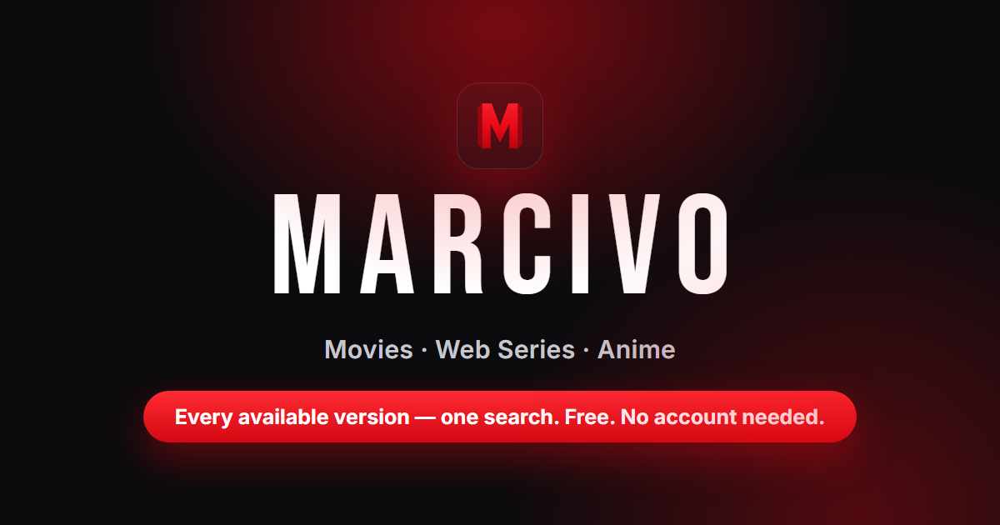

# Marcivo — watch movies, web series & anime online

### [marcivo.teraplayer.in](https://marcivo.teraplayer.in/) — free, no account, no install

One search lines up **every available version of a title** — 480p to 2160p with
audio tracks and file sizes — and plays it in your browser.



A Netflix-style **website**: browse trending movies, web series and anime, open
any title to see the versions that exist right now, press play.
React + Vite frontend on Cloudflare Pages, Express API on Render, TMDB + AniList
metadata, site index search + resolver for playable versions.

## Highlights

- **Every version, one page** — 480p to 2160p with audio tracks and file sizes,
  so you pick once and press play.
- **Series done right** — seasons and episodes from TMDB, versions per episode,
  continue watching.
- **Search + hubs** — [free movies](https://marcivo.teraplayer.in/free-movies),
  [download guide](https://marcivo.teraplayer.in/download-movies),
  [category hubs](https://marcivo.teraplayer.in/category/movies),
  [upcoming releases](https://marcivo.teraplayer.in/upcoming).
- **Built for discovery** — pre-rendered head tags in a Cloudflare Worker,
  dynamic sitemap (460+ title pages), edge caching.

Marcivo doesn't host any files — it links to media indexed from third-party
sources.

## Run it locally

```bash
# 1. API  (port 3001)
cd backend
copy .env.example .env     # fill TMDB_API_KEY + SITE1..5
npm install
npx playwright install chromium   # optional: full local resolver capabilities
npm run dev

# 2. Site  (port 5173) — new terminal
cd frontend
copy .env.example .env     # VITE_API=http://localhost:3001
npm install
npm run dev
```

Open http://localhost:5173.

## Flow

Home (Movies / Anime) → Detail (TMDB / AniList + *Available versions* from
`/api/site-search`) → Watch (pick a version → `POST /api/resolve` → poll →
autoplay).

Routes: `/` · `/category/:cat` · `/search` · `/detail/:kind/:id` ·
`/watch/:kind/:id` · `/free-movies` · `/download-movies` · `/watch-free` ·
`/upcoming` (+ `/shows`, `/anime`) · `/status`

## Ads

Five named slots (header, home, category, detail, footer) are placed and
sized already. Paste your Adstra/Adsterra snippet into
`frontend/src/ads/config.ts`, set `VITE_ADS_ENABLED=1`, redeploy.
Full walkthrough: [ADS.md](ADS.md).

## Deploy

Website on Cloudflare Pages (`marcivo.pages.dev` + your own subdomain), API on
Render. Step-by-step: [DEPLOY.md](DEPLOY.md).

## Notes

- TMDB key stays server-side in `backend/.env`.
- AniList needs no key (GraphQL https://graphql.anilist.co).
- Resolver: plain-HTML fetch lanes in production (LITE profile — no Chromium);
  optional browser lanes when built with full dependencies. 6h cache.
- This was an Android app (Capacitor) before; the app shell, splash screen and
  `frontend/android/` were removed when it became a website. Still in git
  history if needed.
